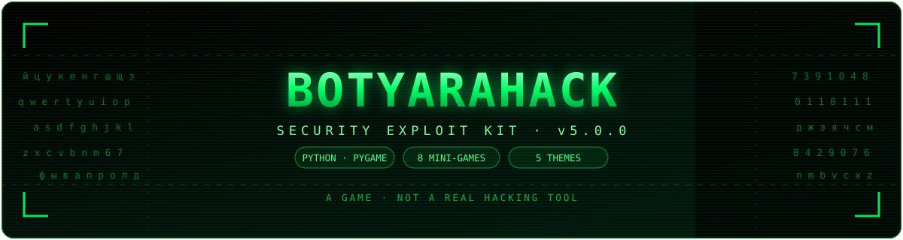
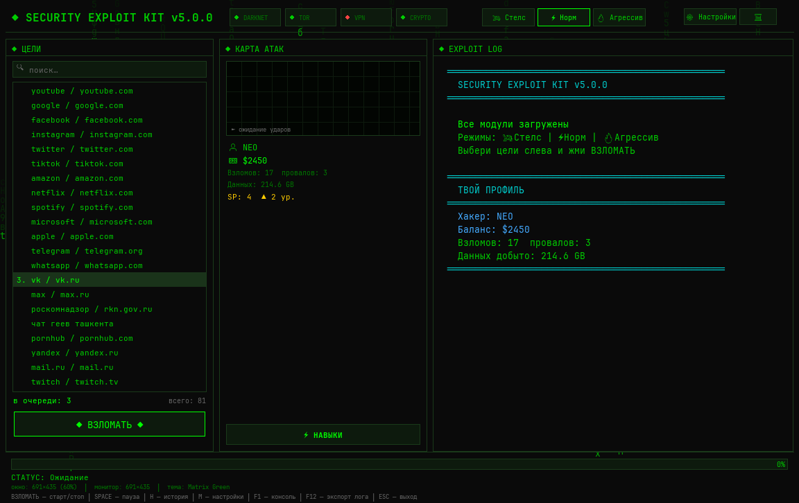
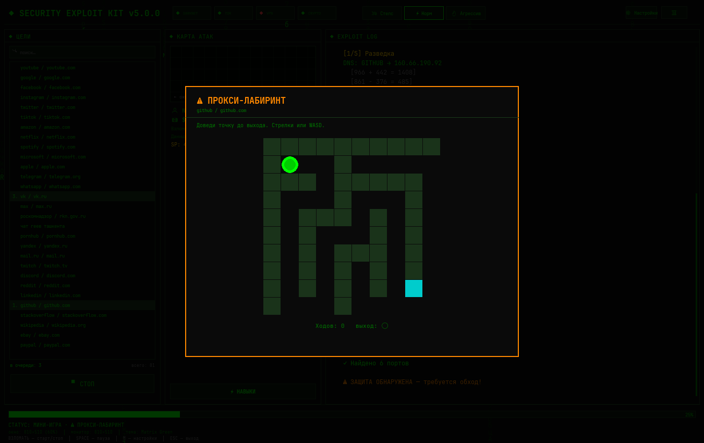
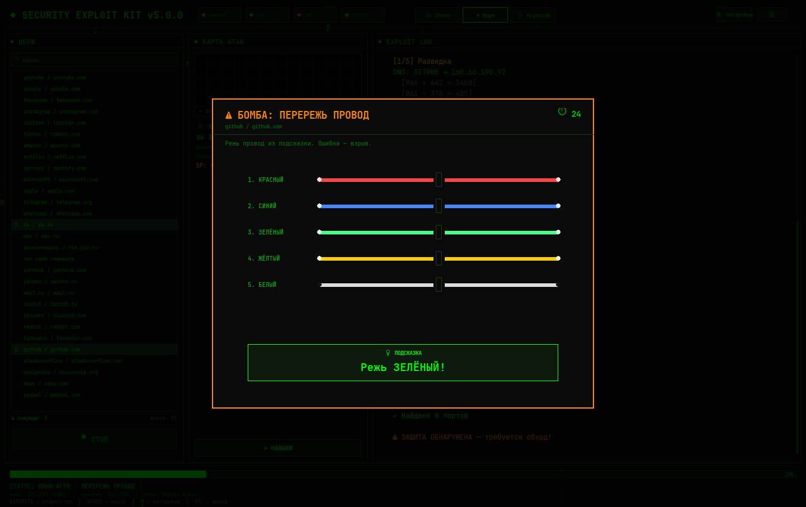
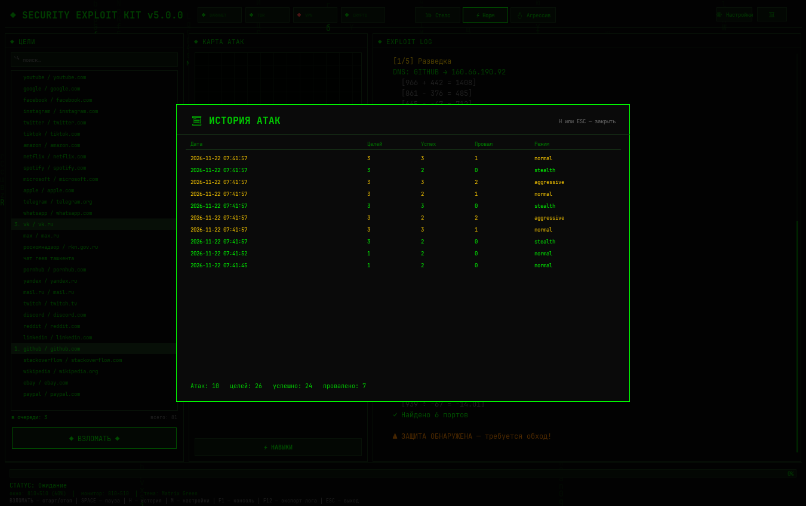
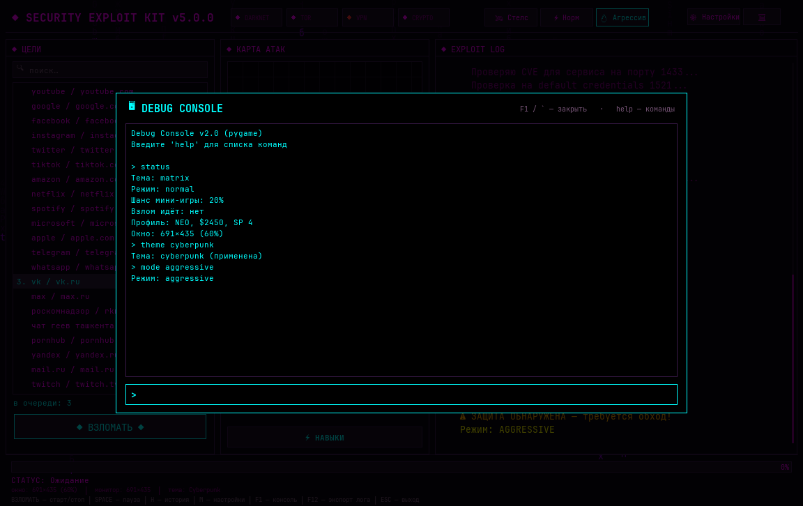
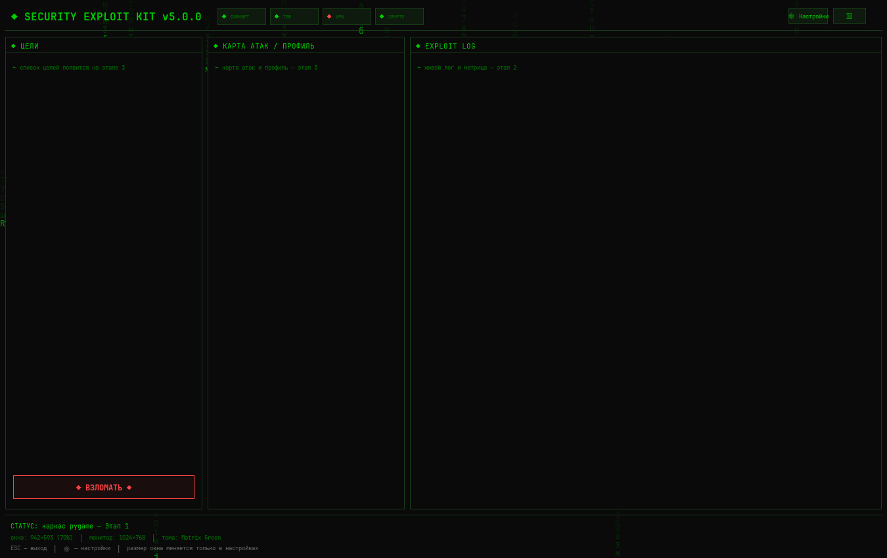
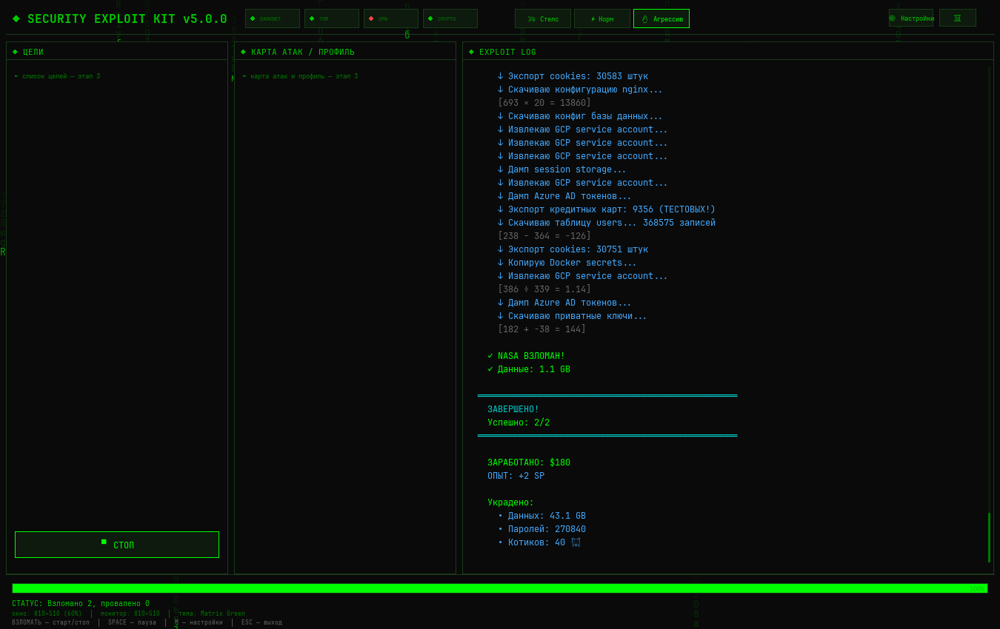
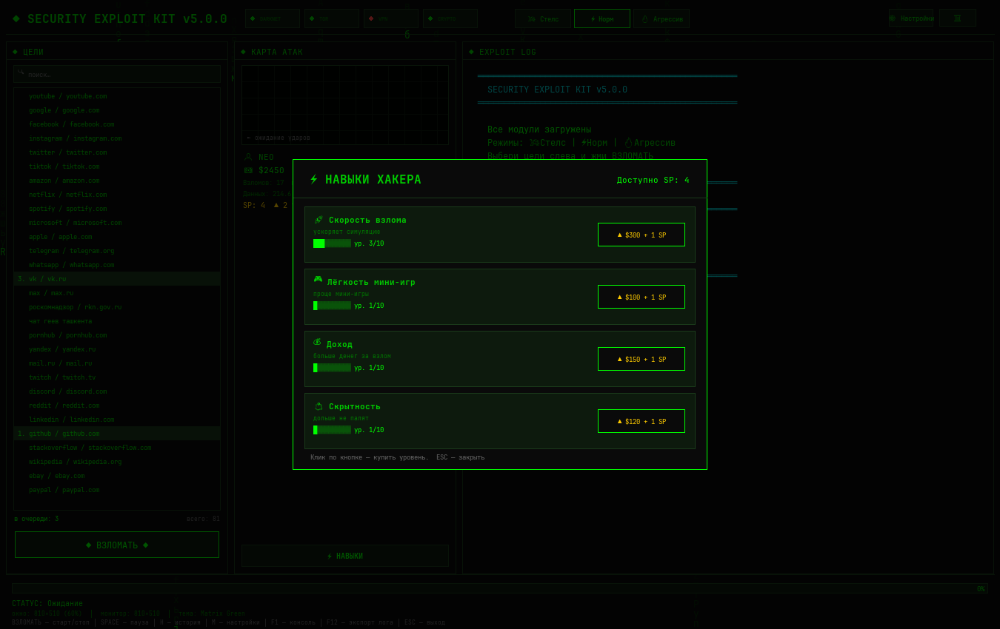

<div align="center">



# 💀 botyarahack

**A hacker terminal simulator you can actually play.** 🎮

*Matrix rain, ASCII art, live exploit log, five themes, eight mini-games.*

> ⚠️ **This is a game, not a real hacking tool.** Nothing here touches a network:
> every "password", "port" and "database" is a random number. 🎲

[🇷🇺 Русская версия](README.ru.md) · [🚀 Quick start](#-quick-start) · [🕹 Controls](#-controls) · [🧩 Structure](#-structure)


</div>

---

## 🚀 Quick start

```bash
python3 run.py            # 🎮 new pygame version (default)
python3 run.py legacy     # 🖥 old tkinter version from legacy/
```

Dependencies: Python 3.8+ and `pygame` (or `pygame-ce`). Fonts are already in the
repo, so the game runs fully offline. 📴

```bash
python3 -m venv .venv
.venv/bin/pip install pygame        # or pygame-ce
.venv/bin/python run.py
```

`tkinter` (legacy version only) comes from the OS, not from pip — see
[`requirements.txt`](requirements.txt).

---

## ✨ What's inside

| | Feature | |
|---|---|---|
| 🖥 | **Autofit window** | picks 94% of screen width / 89% of height, keeps 1152×726 proportions, never more than 175% |
| 🔒 | **No drag-resize** | the window can't be pulled by mouse — the size lives in settings only |
| ✨ | **Smooth scaling** | the UI scales up to the window crisp and blur-free; on by default, toggle in settings |
| 🎨 | **5 themes** | Matrix Green, Cyberpunk, Blood Red, Ocean Blue, Retro Amber — switch without restart |
| 📜 | **Live log** | coloured lines, word wrap, scrollback, 4000-line cap |
| 🎯 | **Targets** | queue by click order, search, add your own |
| 🗺 | **Attack map** | fading strike rings |
| 👤 | **Profile & skills** | money, XP, four upgrades — shared with the tkinter version |
| 🎮 | **8 mini-games** | maze, bomb, code typing, safe, tic-tac-toe, sequence, RPS, math |
| 📊 | **History & console** | attack history, debug console, log export |

---

## 🕹 Controls

| Key | Action |
|-----|--------|
| `ВЗЛОМАТЬ` button | 🚀 start attack / ⏹ stop |
| `Space` | ⏸ pause / continue |
| `Esc` | ⏹ cancel attack → close menu → quit |
| `M` | ⚙ settings |
| `H` | 📜 attack history |
| `F1` or `` ` `` | 🖥 debug console |
| `F12` | 💾 export log to file |
| `F11` | 🖵 fullscreen |
| click a target | ➕ / ➖ add or remove from the attack queue |
| click the search box | 🔍 filter targets by name |

<div align="center">

</div>

---

## 🧩 Structure

```
run.py                  launcher: pygame (default) or legacy
gamedev/                new pygame version
  config.py             themes, ASCII logos, constants (generated from legacy)
  gamedata.py           targets and flavour text (checked against legacy by tests)
  display.py            window size math for any monitor
  settings.py           settings, shared with the tkinter version
  theme.py              palettes, colour dimming
  screen.py             logical 1152×726 canvas + scaling
  widgets.py            buttons, panels, dropdowns, checkboxes, sliders
  background.py         matrix rain
  attack.py             hack simulation: a dt-driven state machine, no threads
  logpanel.py           scrollable log with coloured lines
  targets.py            target list, attack queue, search
  attackmap.py          attack map with fading pings
  profile.py            player profile and skills (shared file)
  minigames.py          eight mini-games on one base class
  history.py            attack history (shared file)
  console.py            debug console: themes, modes, mini-games
  app.py                main window, glue between log, attack and menu
legacy/hacker-app.py    old tkinter version, still playable
assets/fonts/           offline fonts + loader with glyph fallbacks
assets/banners/         SVG banners (English and Russian)
assets/preview/         screenshots rendered headless
tools/render_preview.py renders frames to PNG without a display
tests/                  legacy, fonts, pygame skeleton, simulation, mini-games
```

---

## ⚙️ How the simulation works

The tkinter version ran the hack in a background thread and slept in
`time.sleep()`. The pygame version is a **state machine** instead: each frame the
engine receives `dt` and advances through phases
(recon → scan → defence → exploit → access → extract).

That means pausing is just "don't feed it `dt`", and STOP takes effect instantly —
no orphaned threads, no post-quit log lines. 🧵❌

---

## 🎮 Mini-games

When a target is protected, a mini-game opens:

| Game | What you do |
|------|-------------|
| 🌀 **Maze** | reach the exit — every maze is freshly generated |
| 💣 **Bomb** | cut the right wire before the timer runs out |
| ⌨️ **Code typing** | retype the code; the wrong character is highlighted |
| 🔐 **Safe** | guess 1–100 in seven tries, the range bar shrinks |
| ❌⭕ **Tic-tac-toe** | beat the firewall; a draw still counts as a win |
| 🟥🟩 **Sequence** | repeat the flashing code for three rounds |
| 🪨✂️📄 **Rock-paper-scissors** | win two rounds against a deliberately dumb bot |
| 🧮 **Math** | solve five problems in 45 seconds |

All of them run on `dt` with no `after()` callbacks, so animation is identical at
30 and 144 FPS. `Esc` gives up — the engine records a failure and moves on. 🏃

<div align="center">


</div>

---

## 📊 History, console and profile

* 📜 `H` — attack history, stored in `~/.hacker_history.json` (shared with legacy).
* 🖥 `F1` — debug console: `theme ocean`, `mode aggressive`, `chance 50`,
  `minigame maze`, `status`. Handy for testing a mini-game without a full run.
* 💾 `F12` — dump the current log to `~/botyarahack_log_<date>.txt`.
* 👤 Player profile lives in `~/.hacker_profile.json`, also shared with the
  tkinter version: money, XP, stats and the four skills
  🚀 speed · 🎮 easy mini-games · 💰 income · 👻 stealth.

<div align="center">


</div>

---

## 🧪 Tests

```bash
python3 tests/test_legacy_fixes.py     # fixes in the tkinter version   (15)
python3 tests/test_fonts.py            # fonts and glyph fallbacks      (7)
python3 tests/test_gamedev.py          # pygame skeleton, sizes, menus  (16)
python3 tests/test_stage2.py           # hack simulation and log        (19)
python3 tests/test_stage3.py           # targets, map, profile, console (26)
python3 tests/test_minigames.py        # mini-game logic and rendering  (24)
```

**107 tests**, no display required — everything runs under `SDL_VIDEODRIVER=dummy`.

---

## 📸 Screenshots

All frames in [`assets/preview/`](assets/preview/) are rendered headless by
[`tools/render_preview.py`](tools/render_preview.py) — no X server needed. 🖼

<div align="center">



</div>

---

## 🏷 Themes

| Theme | Vibe |
|-------|------|
| 🟩 Matrix Green | the classic falling-code green |
| 🟪 Cyberpunk | magenta and cyan |
| 🟥 Blood Red | alarm red on black |
| 🟦 Ocean Blue | cold deep-water tones |
| 🟧 Retro Amber | old monochrome CRT |

Change it in ⚙ settings, from the debug console, or by editing
`~/.hacker_settings.json`. No restart needed. ♻️

---

## 🤝 Notes

The tkinter version stays in [`legacy/`](legacy/) and remains playable — both
versions read the same settings, profile and history files, so progress carries
over. Windows is supported; line endings are normalised by `.gitattributes`.

## 📄 License

See [`LICENSE`](LICENSE). Fonts ship under their own licenses —
see [`assets/fonts/`](assets/fonts/).

<div align="center">

**[🇷🇺 Читать по-русски](README.ru.md)**

</div>
