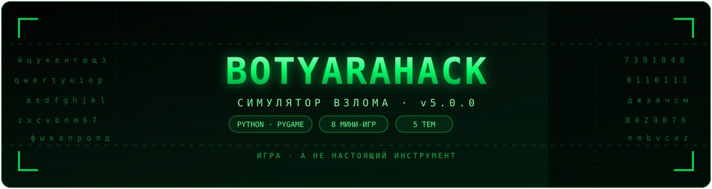
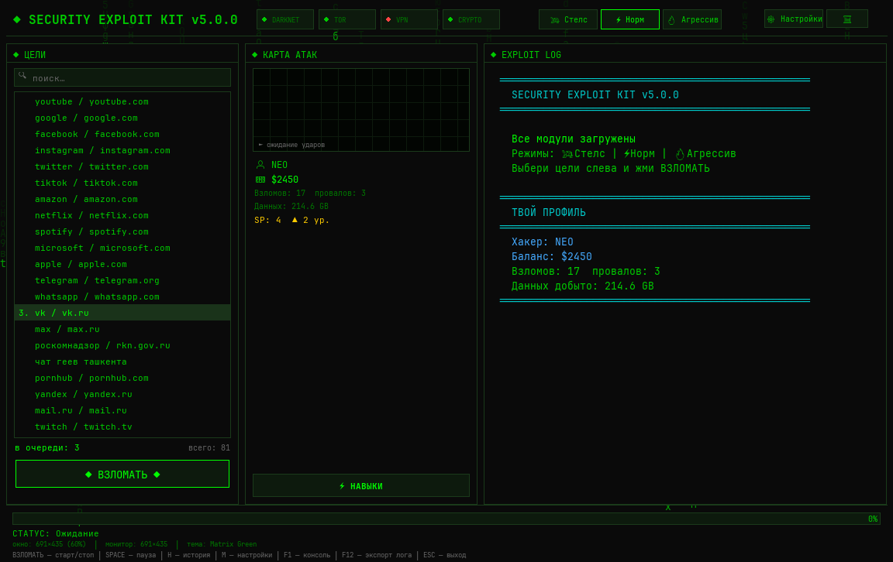
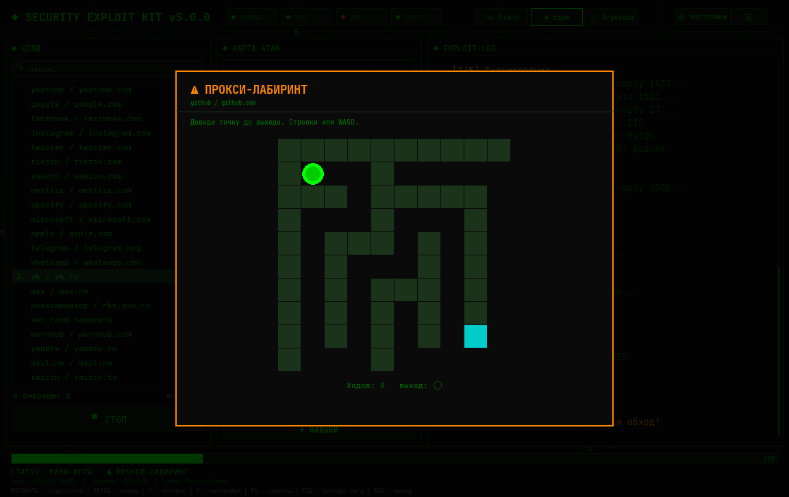
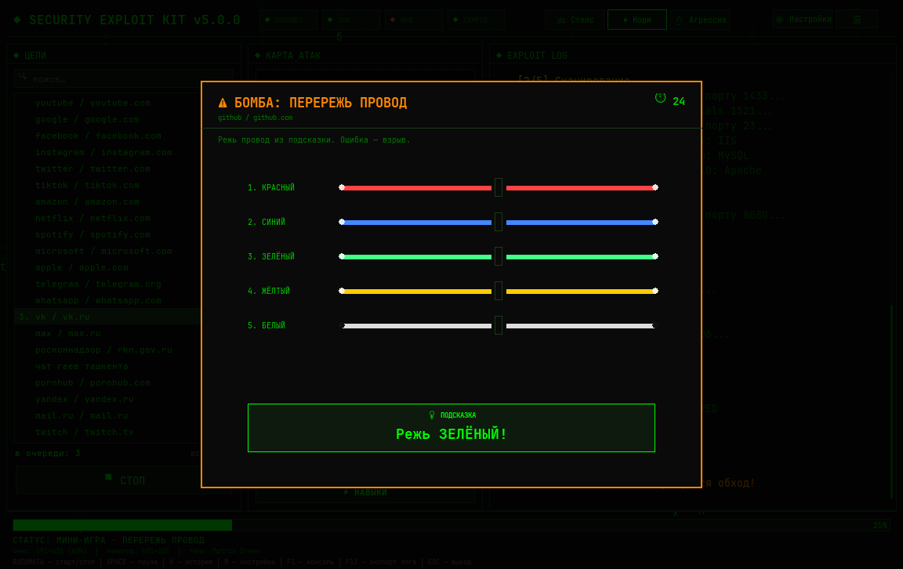
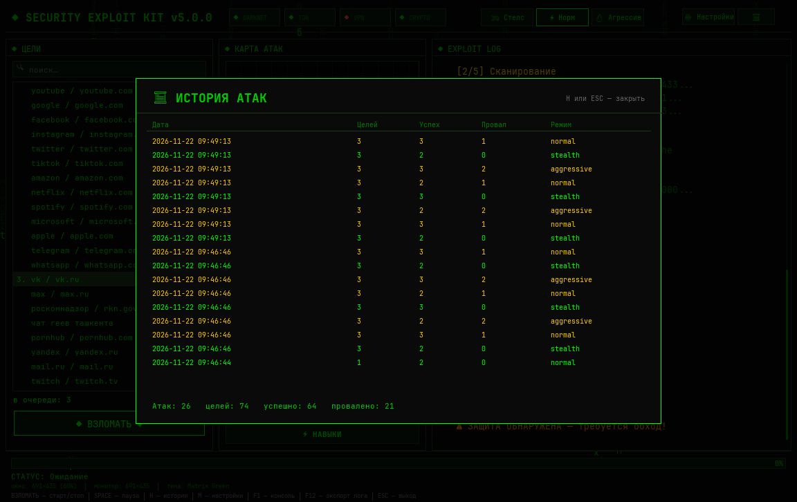
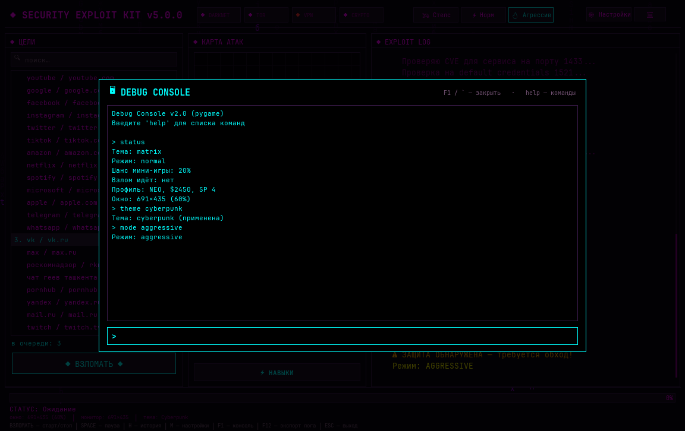
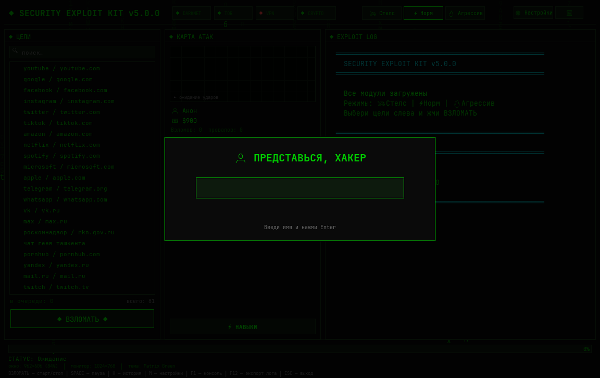
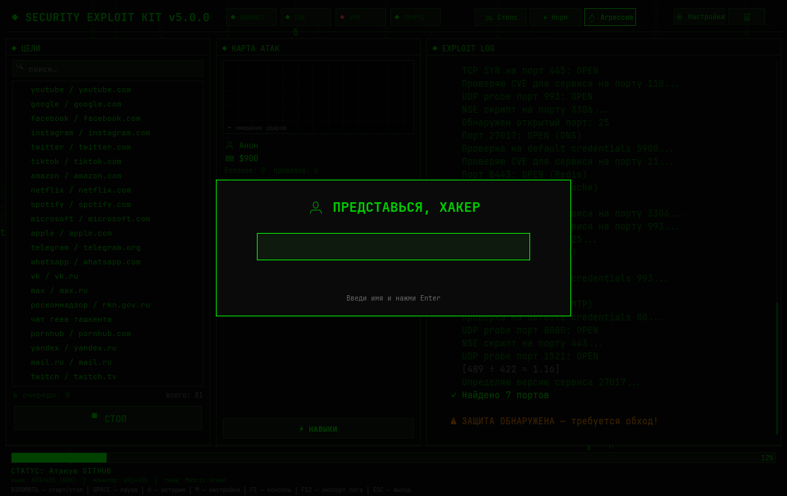
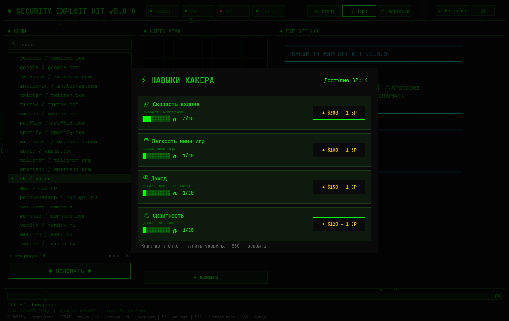

<div align="center">



# 💀 botyarahack

**Симулятор терминала хакера, в который реально можно играть.** 🎮

*Матричный дождь, ASCII-графика, живой лог взлома, пять тем, восемь мини-игр.*

> ⚠️ **Это игра, а не настоящий инструмент для взлома.** Ничего здесь не лезет в сеть:
> каждый «пароль», «порт» и «база данных» — случайное число. 🎲

[🇬🇧 English version](README.md) · [🚀 Быстрый старт](#-быстрый-старт) · [🕹 Управление](#-управление) · [🧩 Структура](#-структура)


</div>

---

## 🚀 Быстрый старт

```bash
python3 run.py            # 🎮 новая версия на pygame (по умолчанию)
python3 run.py legacy     # 🖥 старая версия на tkinter из legacy/
```

Зависимости: Python 3.8+ и `pygame` (или `pygame-ce`). Шрифты уже лежат в
репозитории, так что игра работает полностью офлайн. 📴

```bash
python3 -m venv .venv
.venv/bin/pip install pygame        # или pygame-ce
.venv/bin/python run.py
```

`tkinter` (только для старой версии) ставится средствами ОС, а не через pip —
подробности в [`requirements.txt`](requirements.txt).

---

## ✨ Что внутри

| | Возможность | |
|---|---|---|
| 🖥 | **Окно под монитор** | 94% ширины и 89% высоты экрана, пропорции 1152×726, не больше 175% |
| 🔒 | **Без растягивания мышью** | окно не тянется за угол — размер живёт только в настройках |
| 🎨 | **5 тем** | Matrix Green, Cyberpunk, Blood Red, Ocean Blue, Retro Amber — без перезапуска |
| 📜 | **Живой лог** | цветные строки, перенос по словам, прокрутка, лимит 4000 строк |
| 🎯 | **Цели** | очередь по порядку кликов, поиск, свои цели |
| 🗺 | **Карта атак** | затухающие кольца ударов |
| 👤 | **Профиль и навыки** | деньги, опыт, четыре прокачки — общие с версией на tkinter |
| 🎮 | **8 мини-игр** | лабиринт, бомба, набор кода, сейф, крестики-нолики, последовательность, КНБ, математика |
| 📊 | **История и консоль** | история атак, консоль отладки, экспорт лога |

---

## 🕹 Управление

| Клавиша | Действие |
|---------|----------|
| кнопка `ВЗЛОМАТЬ` | 🚀 старт атаки / ⏹ стоп |
| `Space` | ⏸ пауза / продолжить |
| `Esc` | ⏹ отмена атаки → закрыть меню → выход |
| `M` | ⚙ настройки |
| `H` | 📜 история атак |
| `F1` или `` ` `` | 🖥 консоль отладки |
| `F12` | 💾 экспорт лога в файл |
| `F11` | 🖵 полный экран |
| клик по цели | ➕ / ➖ добавить или убрать из очереди атаки |
| клик по «поиск» | 🔍 фильтр целей по названию |

<div align="center">

</div>

---

## 🧩 Структура

```
run.py                  запуск: pygame (по умолчанию) или legacy
gamedev/                новая версия на pygame
  config.py             темы, ASCII-логотипы, константы (генерируется из legacy)
  gamedata.py           цели и тексты (сверяются с legacy тестами)
  display.py            расчёт размера окна под любой монитор
  settings.py           настройки, общие с tkinter-версией
  theme.py              палитры, затемнение цветов
  screen.py             логический холст 1152×726 + масштабирование
  widgets.py            кнопки, панели, списки, чекбоксы, слайдеры
  background.py         матричный дождь
  attack.py             симуляция взлома: автомат на dt, без потоков
  logpanel.py           прокручиваемый лог с цветными строками
  targets.py            список целей, очередь атаки, поиск
  attackmap.py          карта атак с затухающими точками
  profile.py            профиль игрока и навыки (общий файл)
  minigames.py          восемь мини-игр на общем каркасе
  history.py            история атак (общий файл)
  console.py            консоль отладки: темы, режимы, мини-игры
  app.py                главное окно, связка лога, атаки и меню
legacy/hacker-app.py    старая версия на tkinter, ещё играбельная
assets/fonts/           офлайн-шрифты + загрузчик с фолбэками
assets/banners/         SVG-баннеры (русский и английский)
assets/preview/         скриншоты, отрендеренные без дисплея
tools/render_preview.py рендер кадров в PNG без дисплея
tests/                  legacy, шрифты, каркас pygame, симуляция, мини-игры
```

---

## ⚙️ Как устроена симуляция

В версии на tkinter взлом шёл в фоновом потоке и спал в `time.sleep()`.
В версии на pygame это **автомат**: каждый кадр движок получает `dt` и
продвигается по фазам (разведка → сканирование → защита → эксплуатация →
доступ → извлечение).

Из этого следует: пауза — это просто «не передавать `dt`», а СТОП срабатывает
мгновенно — без осиротевших потоков и без строк лога после закрытия. 🧵❌

---

## 🎮 Мини-игры

Если цель защищена, открывается мини-игра:

| Игра | Что делать |
|------|------------|
| 🌀 **Лабиринт** | дойти до выхода — каждый лабиринт генерируется заново |
| 💣 **Бомба** | перерезать нужный провод, пока идёт таймер |
| ⌨️ **Набор кода** | повторить код; ошибочный символ подсвечивается |
| 🔐 **Сейф** | угадать 1–100 за семь попыток, шкала диапазона сужается |
| ❌⭕ **Крестики-нолики** | обыграть файрволл; ничья тоже считается победой |
| 🟥🟩 **Последовательность** | повторить вспышки за три раунда |
| 🪨✂️📄 **Камень-ножницы-бумага** | выиграть два раунда у нарочно тупого бота |
| 🧮 **Математика** | решить пять примеров за 45 секунд |

Всё на `dt`, без колбэков `after()`, поэтому анимация одинакова на 30 и 144 FPS.
`Esc` — сдаться: движок засчитает провал и пойдёт дальше. 🏃

<div align="center">


</div>

---

## 📊 История, консоль и профиль

* 📜 `H` — история атак, лежит в `~/.hacker_history.json` (общая с legacy).
* 🖥 `F1` — консоль отладки: `theme ocean`, `mode aggressive`, `chance 50`,
  `minigame maze`, `status`. Удобно проверить мини-игру, не проходя весь взлом.
* 💾 `F12` — сохранить текущий лог в `~/botyarahack_log_<дата>.txt`.
* 👤 Профиль игрока живёт в `~/.hacker_profile.json`, тоже общий с версией на
  tkinter: деньги, опыт, статистика и четыре навыка
  🚀 скорость · 🎮 лёгкость мини-игр · 💰 доход · 👻 скрытность.

<div align="center">


</div>

---

## 🧪 Тесты

```bash
python3 tests/test_legacy_fixes.py     # исправления старой версии        (15)
python3 tests/test_fonts.py            # шрифты и фолбэки                (7)
python3 tests/test_gamedev.py          # каркас pygame, размеры, меню    (16)
python3 tests/test_stage2.py           # симуляция взлома и лог          (19)
python3 tests/test_stage3.py           # цели, карта, профиль, консоль   (26)
python3 tests/test_minigames.py        # логика и отрисовка мини-игр     (24)
```

**107 тестов**, дисплей не нужен — всё идёт под `SDL_VIDEODRIVER=dummy`.

---

## 📸 Скриншоты

Все кадры в [`assets/preview/`](assets/preview/) отрендерены без дисплея
скриптом [`tools/render_preview.py`](tools/render_preview.py) — X-сервер не нужен. 🖼

<div align="center">



</div>

---

## 🏷 Темы

| Тема | Настроение |
|------|------------|
| 🟩 Matrix Green | классический падающий зелёный код |
| 🟪 Cyberpunk | маджента и циан |
| 🟥 Blood Red | тревожный красный на чёрном |
| 🟦 Ocean Blue | холодные глубоководные тона |
| 🟧 Retro Amber | старый монохромный ЭЛТ |

Переключается в ⚙ настройках, из консоли отладки или правкой
`~/.hacker_settings.json`. Перезапуск не нужен. ♻️

---

## 🤝 Заметки

Версия на tkinter остаётся в [`legacy/`](legacy/) и всё ещё играбельна — обе
версии читают одни и те же файлы настроек, профиля и истории, так что прогресс
переносится. Windows поддерживается; переводы строк нормализует `.gitattributes`.

## 📄 Лицензия

См. [`LICENSE`](LICENSE). Шрифты — под своими лицензиями, см.
[`assets/fonts/`](assets/fonts/).

<div align="center">

**[🇬🇧 Read in English](README.md)**

</div>
